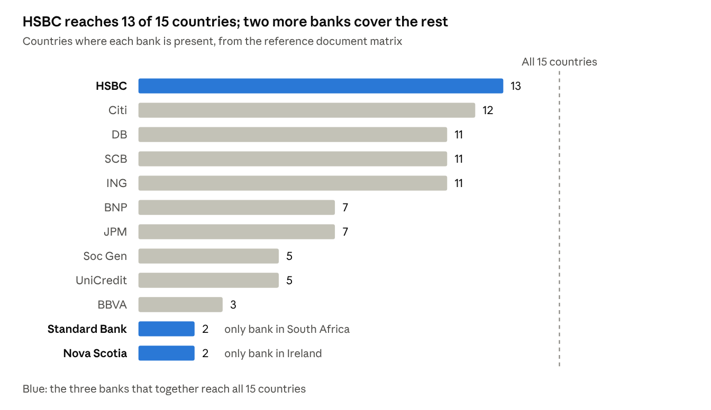
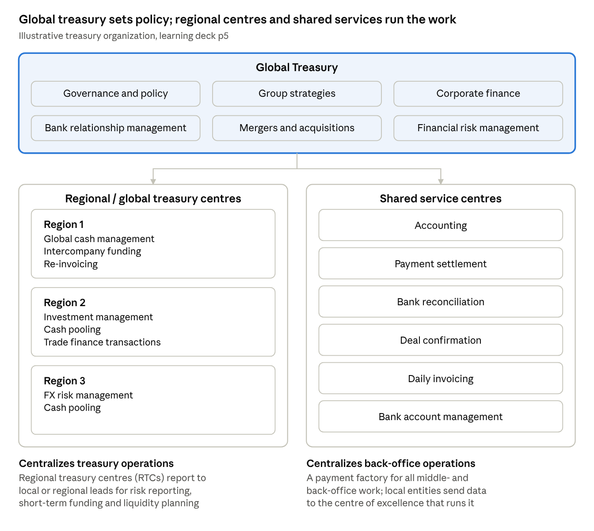
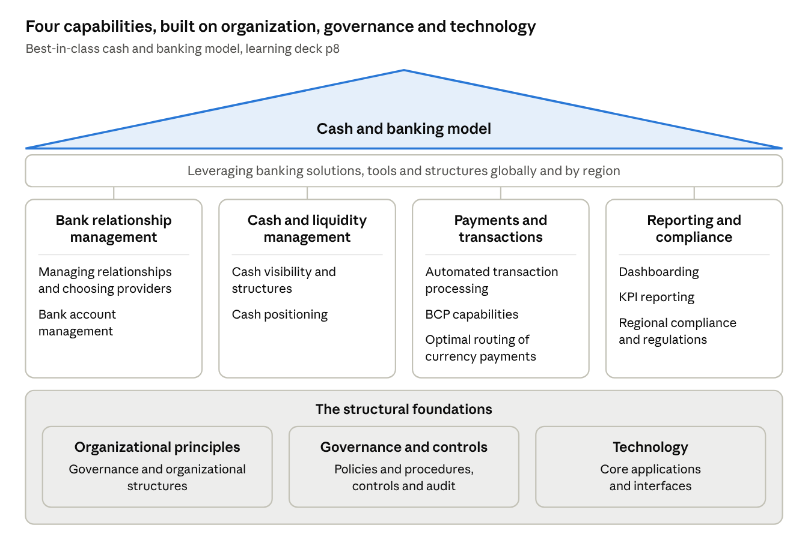

# EY CAFTA Case Championship 2026 – Case Pack

21 October 2026

## At a glance

The case asks you to redesign the treasury of Global Consumer Products Ltd (GCPL), answering seven CFO questions in a PDF deck plus a video of up to 4 minutes. The welcome page sets the deadline as 20 October, which is one day before this doc's date, so check whether it still applies or was extended.

| Item | Detail |
| --- | --- |
| Competition | EY CAFTA Case Championship, 12th edition (2026) |
| Case title | Treasury transformation: Strategy to execution |
| Company | Global Consumer Products Ltd (GCPL), consumer goods, HQ in India |
| Deadline | 20 October 2026 (as stated on the welcome page) |
| Main deliverable | PPT converted to PDF, at most 2 MB, at most 17 slides plus intro and thank-you slides |
| Video | At most 4 minutes, uploaded to your own YouTube account as Unlisted |
| Optional extras | One Excel workbook (or dashboard file), at most 1 MB |
| Where the link goes | A Google Form that EY will share later |
| Learning session | Global Cash and Banking Transformation for MNCs (August 2026), Nushad Irani, Senior Manager, EY |

These notes come from four PDFs on the EY Knorish course page: the instructions deck (10 pages), the reference document (3 pages), the learning deck (15 pages) and the sample PPT template (10 pages). Page 10 of the instructions deck and page 3 of the reference document were not in the screenshots.

## The case: GCPL treasury transformation

GCPL grew through acquisitions over the last 10 years and now runs a decentralized, spreadsheet-based treasury; the CFO wants it centralized and scalable.

GCPL is a multinational consumer goods company headquartered in India, with operations across Asia, Europe, North America and the Middle East. Because of its acquisition-led growth:

- Treasury activities are decentralized.
- Each subsidiary manages its own bank accounts.
- Cash forecasting is done separately for each entity.
- Investments are managed locally.
- Banking relationships have increased significantly.
- Treasury reporting is largely spreadsheet-based.

What the case is judged on, in EY's words: transforming a decentralized treasury into a "centralized, technology-enabled, and scalable treasury organization." The focus areas are organization structure, centralization, cash and liquidity management, bank account management, governance and controls, and risk management. Participants are expected to design a future-state operating model that improves efficiency, strengthens controls and improves liquidity visibility.

## Current challenges

The brief lists problems in six areas. The two hard numbers are 75+ bank accounts and 25+ banking partners.

| Area | Challenges |
| --- | --- |
| Treasury organization | No global treasury operating model · roles and responsibilities not clearly defined · no segregation between front, middle and back office |
| Technology | No Treasury Management System (TMS) · manual reporting · limited automation · multiple ERP systems |
| Cash management | Excess cash held in some entities while other entities keep borrowing · no group-wide liquidity visibility |
| Banking landscape | 75+ bank accounts · 25+ banking partners · high banking charges · duplicate accounts across geographies |
| Investment management | Different investment practices across regions · no centralized oversight · no standardized investment policy adherence |
| Risk and compliance | Limited treasury controls · inconsistent compliance monitoring · limited visibility on counterparty exposure |

## CFO's questions

There are seven questions, and every slide that answers one must name its letter or heading (PPT rule 3). The right-hand column points to the learning-deck pages that help most; that mapping is my suggestion, not EY's.

| # | Question | Learning deck pages to use |
| --- | --- | --- |
| A | Design a future-state Treasury Operating Model. | p5 treasury structures, p8 best-in-class C&B model |
| B | Which treasury activities should be centralized? | p5 global treasury vs regional centres vs shared services, p11 governance |
| C | How would you rationalize the bank account structure? | Reference document matrix, p9 bank relationship management, p12 cash pooling, p13–14 case study |
| D | What technology landscape should be adopted? | p11 technology, p13 one channel (e.g. SWIFT) and ERP as source system |
| E | What benefits will be achieved? | p6–7 risks and costs of a decentralized structure (the benefits are their reverse) |
| F | What KPIs should be monitored? | p9 bank scorecards, p10 reporting, dashboards and benchmarking |
| G | Future recommendations. | p15 in closing |

## Reference document: bank presence by country

Three banks are enough to reach all 15 countries: HSBC covers 13, and the two gaps each have only one bank (South Africa: Standard Bank; Ireland: Nova Scotia). This is the main input for question C. The table is copied from page 2 of the reference document; the counts and the three-bank finding are my working from it.

| Country | DB | HSBC | BNP | Soc Gen | SCB | JPM | Citi | ING | UniCredit | Standard Bank | Nova Scotia | BBVA |
| --- | --- | --- | --- | --- | --- | --- | --- | --- | --- | --- | --- | --- |
| South Africa | No | No | No | No | No | No | No | No | No | Yes | No | No |
| Bangladesh | Yes | Yes | No | No | Yes | No | Yes | No | No | No | No | No |
| France | No | Yes | Yes | Yes | Yes | No | Yes | Yes | Yes | No | No | No |
| Germany | Yes | Yes | Yes | Yes | Yes | Yes | Yes | Yes | Yes | No | No | No |
| Italy | Yes | Yes | Yes | No | Yes | No | Yes | Yes | Yes | No | No | Yes |
| Spain | Yes | Yes | No | No | No | Yes | Yes | Yes | No | No | No | Yes |
| Netherlands | Yes | Yes | No | No | No | No | Yes | Yes | No | No | No | No |
| Ireland | No | No | No | No | No | No | No | No | No | No | Yes | No |
| UK | Yes | Yes | No | No | Yes | No | No | No | Yes | Yes | No | No |
| India | Yes | Yes | Yes | Yes | Yes | Yes | Yes | Yes | No | No | No | No |
| Dubai | No | Yes | No | No | Yes | Yes | Yes | Yes | No | No | No | No |
| Canada | Yes | Yes | Yes | Yes | Yes | Yes | Yes | Yes | No | No | Yes | No |
| USA | Yes | Yes | Yes | No | Yes | Yes | Yes | Yes | No | No | No | No |
| Mexico | Yes | Yes | No | No | Yes | No | Yes | Yes | Yes | No | No | No |
| Brazil | Yes | Yes | Yes | Yes | Yes | Yes | Yes | Yes | No | No | No | Yes |

The learning deck's target is 5–8 global strategic banks. After the three above, the widest backups are Citi, then DB, SCB and ING.

## Learning material: Global Cash and Banking Transformation for MNCs

The deck's fix for a decentralized treasury: a global treasury that sets policy, regional centres and shared services that run operations, 5–8 strategic banks, one bank channel (e.g. SWIFT) and pooled liquidity. It is the EY session deck, 15 pages, dated 21 August 2026.

Trainer: Nushad Irani, Senior Manager, EY (Mumbai). 10+ years consulting on treasury transformation, benchmarking, cost optimization and debt raising; 2.5 years in a telecom treasury (cash and liquidity, debt, trade finance); 1 year in bank back-office operations (FX and money market). MBA Finance, B.Com. Contact: nushad.irani@in.ey.com.

### What global cash and banking means (p4)

Global cash and banking is the systems and processes for managing cash and conducting financial transactions on a global scale: international banking, currency exchange, cross-border payments and moving funds between countries.

Key elements: global banking relationships · bank account management · centralized control · global cash management · currency risk management · systems harmony · automation · compliance.

### What treasury structures look like (p5)

In the deck's words, global treasuries exist to drive cost efficiency, use synergies across markets and build specialist financial expertise. This structure is a ready starting point for questions A and B.

### Risks and costs of a decentralized structure (p6–7)

| Area | Risk or cost |
| --- | --- |
| Idle cash | Surplus cash is not swept from subsidiaries, so interest is lost; daily local reporting gives no group view to cut debt |
| Payments | Local banks may lack the systems to automate transaction processing |
| Compliance | No sanction screening at the payment stage, so a significant compliance and reputational risk under country rules |
| FX | Revenue in many currencies across geographies creates high FX exposure |
| Bank negotiation | Group buying power unused: contracts negotiated locally, no central oversight of bank fees, no common SLAs |
| Reporting | No automated reporting of local accounts to group treasury; several tools to capture bank account data; higher operating cost |
| Systems | Many interfaces across entities, each needing cybersecurity reviews; bespoke systems to maintain every 3–5 years; slow to change |

### The best-in-class cash and banking model (p8)

The four pillars are what treasury delivers; the three foundations are what your operating model for question A has to put in place.

### What world class looks like, by area (p9–11)

| Area | World-class practice |
| --- | --- |
| Bank relationship management | Relationships managed centrally, day-to-day work by operations teams · formal bank reviews with scorecards · routine review of account fees · clear relationship strategy and a balanced banking wallet · the same banks across regions · regular reviews of account structures · standardized bank account management (BAM) documents, opening/closing and resolutions · one central BAM database · liquidity structures that fit the banking architecture |
| Liquidity management | Periodic visibility of all cash balances · cash used to minimise borrowing costs · cash concentrated centrally with fewer accounts, banks and overdrafts · automated cash positioning · from many local banks to a few regional partners with high automation |
| Payments processing | High automation and straight-through processing (STP) · one consistent channel to primary banks · business continuity (BCP) payment capability · regular review and benchmarking |
| Reporting and compliance | Regular reports and dashboards on cash, debt, forecasts and investments · formal reporting on KPIs agreed up front · periodic benchmarking against internal targets and other corporates |
| Governance and organization | Strategy, design and leadership central; operations local · clear scope for group treasury · cash policies, procedures and tools standardized across the group · structures built for efficient operations |
| Policies and procedures | Local execution governed by a central policy · documented desktop procedures that meet corporate standards · globally standardized processes · documented roles and responsibilities |
| Controls and audit | Compliance monitoring matched to the risk profile · a business continuity plan for critical cash functions, tested yearly |
| Technology | One shared platform for treasury and finance cash transactions · one channel for bank interfaces · vendor development of new market initiatives |

### Cash pooling (p12)

Cash pooling concentrates cash by location, currency and account into a single account by end of day, in one or several currencies and locations.

| Type | How it works |
| --- | --- |
| Physical | Funds are swept into one pool account; interest is on actual end-of-day balances after the sweep |
| Notional | Funds stay in each entity's account, with no cross-border movement; interest is paid or received centrally as if all funds were pooled |
| Hybrid | A mix of physical and notional pooling to optimise group liquidity |

### Case study: a leading MNC, current vs future (p13–14)

| Current landscape | What changes | Future landscape |
| --- | --- | --- |
| Many internal systems, no harmonized processes | Complex, diverse C&B processes simplified and harmonized | ERP as the source system; one harmonized C&B process and toolset |
| Many interfaces (H2H, API, e-banking) between banks and systems | Mandatory move to the new landscape, with sanction and fraud screening | One interface between internal systems and banks (one channel, e.g. SWIFT); 500+ bank interfaces become one |
| Many banks with many accounts | Bank architecture rationalized: 5–8 global strategic banks, one central liquidity pool | Fewer banks; automated sweeping and daily reporting of logically held cash balances |

Page 14 shows two account structures, marked "examples only for illustrative purposes":

- Single bank: every entity account is at Citi (Entity A has 2, Entity B has 3), each linked directly to the treasury's Citi account.
- Several banks: the treasury holds a Citi and a Commerzbank account, linked to each other. Entity C's two HSBC accounts feed an HSBC master account that links to the treasury's Citi account. Entity D's two Commerzbank accounts feed a Commerzbank master account that links to the treasury's Commerzbank account.

### In closing (p15)

- Cash and banking transformation is essential to stay competitive in a fast-paced digital world.
- Digital technology improves customer experience, efficiency and cost, security and compliance, and competitive advantage.
- The company in question should consider a cash and banking transformation to stay relevant and competitive.

## Rules and regulations

The rules that can disqualify you are plagiarism (uncited sources), work that is not your own, and missing the deadline.

1. An overall spirit of sportsmanship is expected from all participants throughout the competition.
2. Any violation of the rules may disqualify the team. Any disqualification decision is final.
3. Submissions are final; no changes are allowed after submission.
4. You may use any available resources to research and develop the solution.
5. Only one solution can be submitted per participant or team.
6. Keep to the deadlines; no extensions will be given.
7. All submitted work must be your own. Public materials are allowed but must be properly cited.
8. Failing to cite sources counts as plagiarism and can lead to disqualification.

## Submission instructions

Name every file `CAFTA CC 2026_<Stream Name>_<Participant name>`. The brief contradicts itself on extra files: the welcome page calls annexures (working, dashboard, Excel) mandatory, while PPT rule 7 calls them completely optional. Submitting a small Excel annex satisfies both.

### PPT

1. File name: `CAFTA CC 2026_<Stream Name>_<Participant name>`.
2. File size at most 2 MB. At most 17 slides, not counting the introduction and thank-you slides. An executive summary slide is mandatory.
3. The case has several questions, so each answer must reference the question's heading or number.
4. You may use EY's sample template or your own design. The first slide must show the stream name and participant name.
5. Convert the final PPT to PDF and upload only the PDF. Supporting Excel or dashboard files can be uploaded separately.
6. Put all calculations in a single Excel workbook, one sheet per question, named by question number.
7. Additional files are optional, at most 1 MB each, with the same naming convention as the PPT.

### Video

1. Name it with the same convention (the slide repeats the PPT wording).
2. At most 4 minutes, focused on a summarized solution to the case.
3. Showing your face is optional (infographic videos are fine), but the voice must be yours. If you reach the top solutions and present live at the CAFTA showcase and the voice turns out not to be yours, the solution is disqualified and all winning benefits are cancelled.
4. Make sure any content or infographics in the video are clearly visible. Teams of 2 or 3 need not appear together: one person can record, or each records a part and you combine them before uploading.
5. Dress in formal or business casual attire.
6. Upload to your personal YouTube account and submit the link where instructed.
7. Follow the upload steps below.

### Uploading to YouTube

1. Click the Create icon (top right of YouTube), then Upload video.
2. Select the file. The title must follow the standard format; EY's example title is "CAFTA CC2026 -Treasury transformation: Strategy to execution".
3. Under Visibility, choose Unlisted and click Save (bottom right). Public is allowed, but EY suggests Unlisted.
4. Once published, copy the video link with the copy icon.
5. Paste that link into the Video Link field of the Google Form EY will share later.

## Sample PPT template

EY's 10-page sample is optional, but its cover layout (stream name and participant name) is the one slide you must have. Its footer still reads "27 May 2024 · CAFTA Case Championship 2024", so update it if you use the template.

Style: white content slides, title top left with a thin yellow rule under it, footer with page number and date, font EY Interstate (subtitles Regular 14 pt, descriptions Light 12 pt), charts in yellow and greys.

| Page | Layout | Good for (my suggestion) |
| --- | --- | --- |
| 1 | Cover: yellow panel over a photo with `<<Stream name>>` and `<<Name of Participant>>` | Mandatory first slide |
| 2 | Index: photo left, dark panel right listing sections and sub-sections in yellow | Agenda mapped to questions A–G |
| 3 | Section divider: dark panel, photo, large yellow number and a line of text | Opening each question |
| 4 | Blank content slide with `<<Add title>>` | Executive summary, free layouts |
| 5 | Focused data: a headline and three ring stats (89%, 70%, 68%) with captions | Benefits (E) |
| 6 | Donut chart beside two paragraphs of text | Current-state findings |
| 7 | Two charts: a donut and a stacked column chart by year | Before vs after comparisons |
| 8 | Table: subtitle, description, 12 data columns and a TOTAL row | KPIs (F), bank rationalization (C) |
| 9 | Process: four icon steps (Briefing, Idea generation, Testing, Governance) | Roadmap and recommendations (G) |
| 10 | Two columns with headings and bullets up to five levels | Centralize vs keep local (B) |

## Submission checklist

Tick these off before you submit; each comes from the rules above.

- [ ] Confirm the deadline (the brief says 20 October) and how submissions are collected
- [ ] First slide shows the stream name and participant name(s)
- [ ] Executive summary slide included
- [ ] Questions A–G each answered, with the question letter or heading on its slides
- [ ] At most 17 slides plus intro and thank-you
- [ ] Exported to PDF, at most 2 MB, named `CAFTA CC 2026_<Stream Name>_<Participant name>`
- [ ] Excel annex: one workbook, one sheet per question named by number, at most 1 MB, same naming
- [ ] Every outside source cited
- [ ] Video at most 4 minutes, in your own voice, formal or business casual attire, visuals readable
- [ ] Video uploaded to your YouTube as Unlisted, titled in the standard format
- [ ] Video link pasted into EY's Google Form
